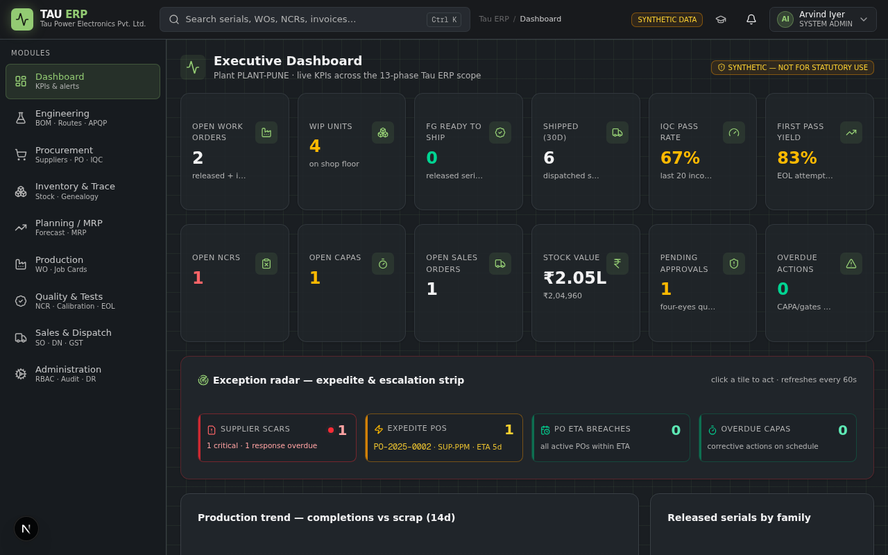
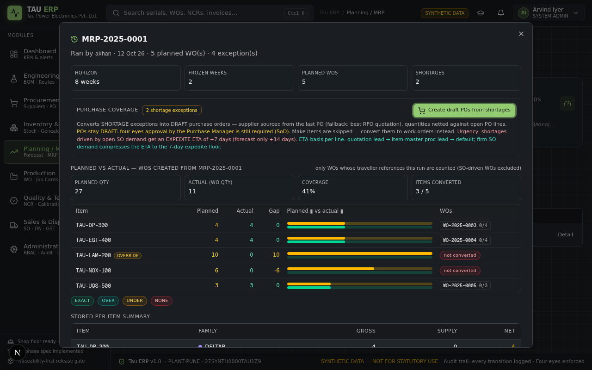

# Tau ERP — Manufacturing ERP Demo

A production-grade **manufacturing ERP** built for *Tau Power Electronics*, running on a faithful port of a full ERPNext-style DocType catalogue (Engineering, Procurement, Planning, Inventory, Production, Quality, Sales & Finance) to **Next.js + Prisma + SQLite**.

> ⚠️ **Demo dataset** — all data in this repository is **synthetic** and runs entirely on **local credentials**. GST/tax logic follows **India rules** (CGST/SGST/IGST, HSN-coded invoices, LUT exports) for demonstration purposes.

---

## ✨ Highlights

| Area | What's inside |
|---|---|
| 📊 **Executive Dashboard** | Live KPIs, OTIF, quality radar, SCAR/CAPA trends, MRP alerts |
| 📐 **Engineering** | Items, multi-level BOMs, routings, ECOs with revision control |
| 🛒 **Procurement** | RFQ → quotation comparison → purchase orders → GRN flow |
| 📅 **Planning** | MRP workbench with planned-vs-actual run detail, capacity view |
| 📦 **Inventory** | Lots/serials, containers, GRN, bin transfers, barcode scan |
| 🏭 **Production** | Work orders, job cards, DFM checks, production tracking |
| 🔬 **Quality** | Inspections, NCR, SCAR with 8D response sheets, CAPA |
| 💰 **Sales & Finance** | Quotations, sales orders, India-GST invoices, delivery |
| 🛡️ **Governance** | RBAC + four-eyes approvals, Decision Register, full audit trail |
| 🧭 **Interactive Product Tours** | Spotlight onboarding tours across all 10 modules |
| 📖 **User Manuals** | Built-in doc-controlled manuals (TAU-ERP-UM-001) with screenshots & print |

## 🖼️ Screenshots

| Dashboard | MRP Workbench |
|---|---|
|  |  |

*(14 more screenshots live in `public/manual/` and render inside the app's **Manuals & Help** view.)*

## 🧰 Tech Stack

- **Next.js 16** (App Router, standalone output) + **TypeScript 5** + **React 19**
- **Tailwind CSS 4** + **shadcn/ui** (New York) + Lucide icons
- **Prisma 6 + SQLite** (zero-ops single-file database)
- **Zustand** (client state) · **TanStack Query** (server state)
- **NextAuth.js v4** ready · single-page hash routing shell

## 🚀 Quick Start (local)

```bash
bun install
cp deploy/.env.production.example .env.local   # adjust DATABASE_URL if you like
bunx prisma generate
bun run dev            # http://localhost:3000
```

First run with an empty DB:

```bash
bunx prisma db push
bun scripts/seed-runner.ts    # seeds the full synthetic India-GST dataset
```

## 🌍 Production Deployment (Hostinger VPS or any Ubuntu server)

One command — installs Bun, builds, registers systemd, configures Caddy with **automatic HTTPS** for your domain:

```bash
sudo bash deploy/deploy.sh erp.yourcompany.com
```

Full walkthrough (DNS, SSL, backups, updates, Docker alternative): **[DEPLOYMENT_GUIDE.md](DEPLOYMENT_GUIDE.md)**

## 📁 Repository Structure

```
src/app/            Next.js App Router (page shell + /api routes)
src/components/     shadcn/ui kit + erp/ feature views
src/lib/erp/        Domain logic, tours, seed constants
prisma/schema.prisma  Full DocType catalogue (30+ models)
db/                 Pre-seeded SQLite demo database
deploy/             VPS deployment kit (systemd, Caddy, Docker)
public/manual/      User-manual screenshots
```

## 📄 License

Demo/educational use. All product names, data and figures are synthetic.
